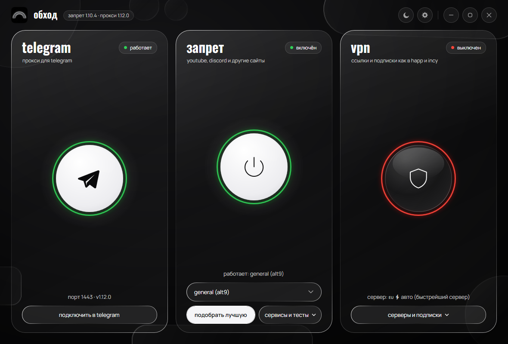
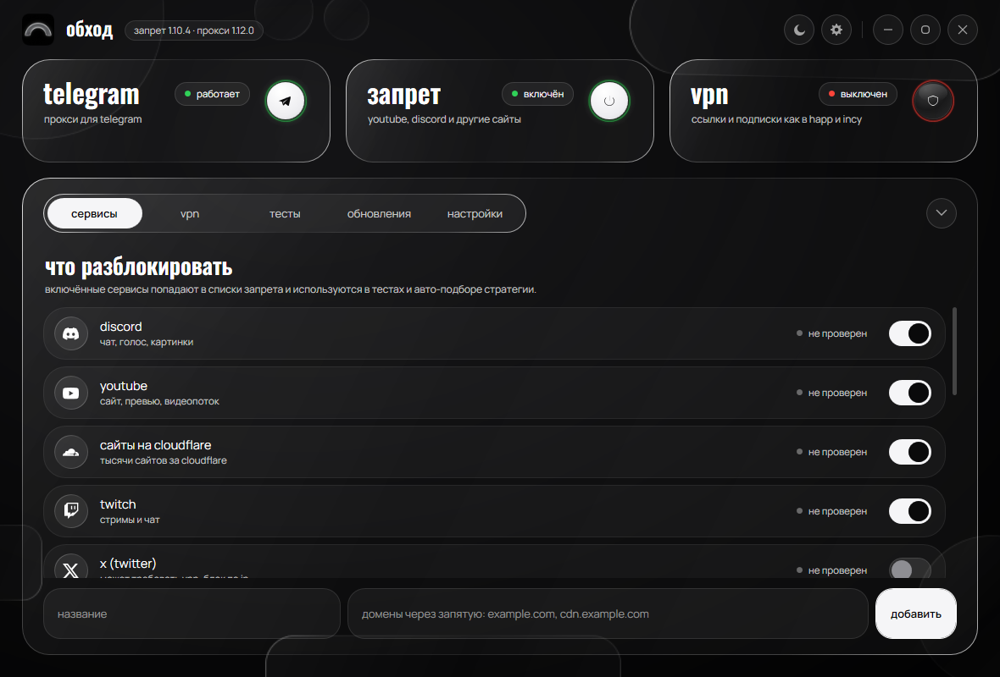
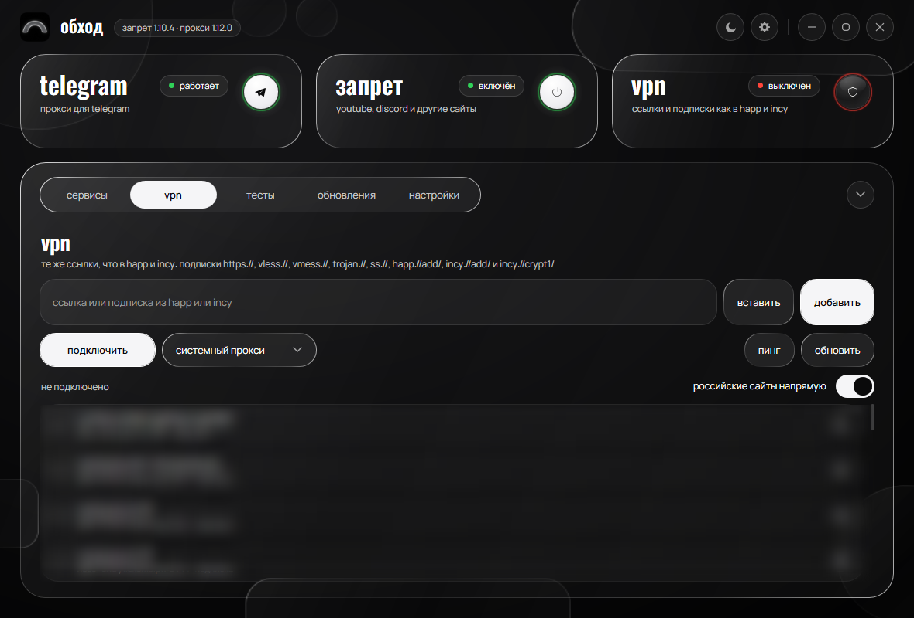
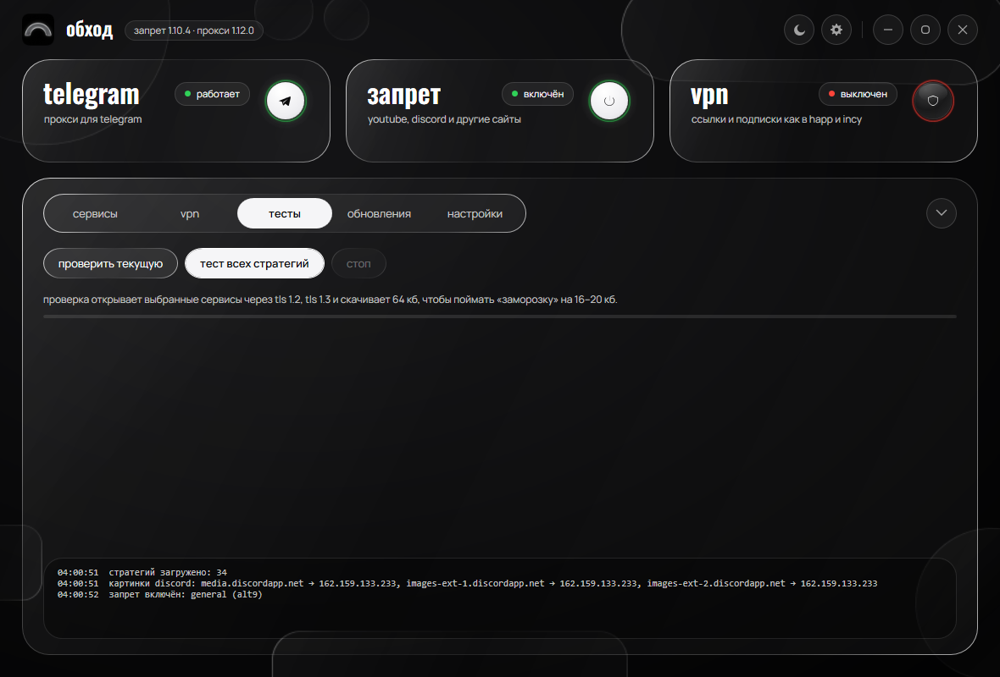
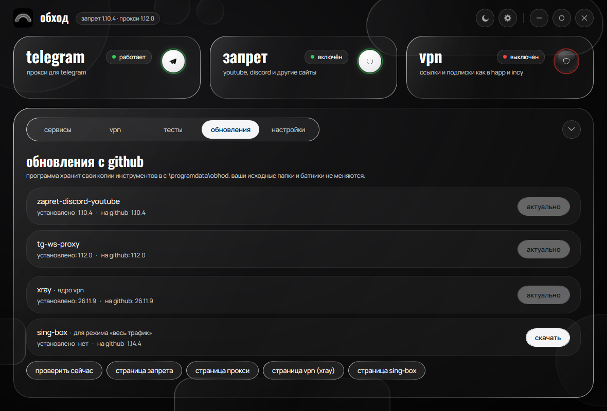
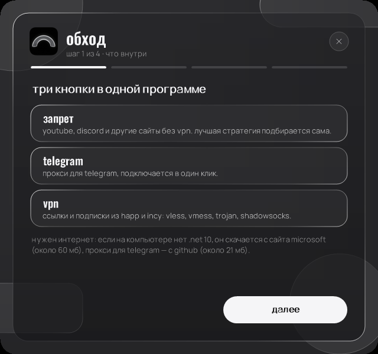
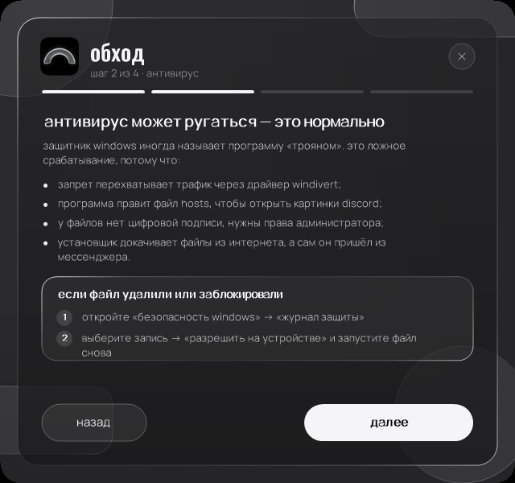
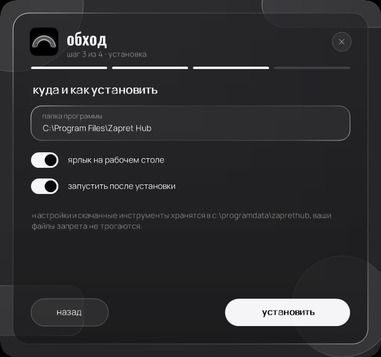
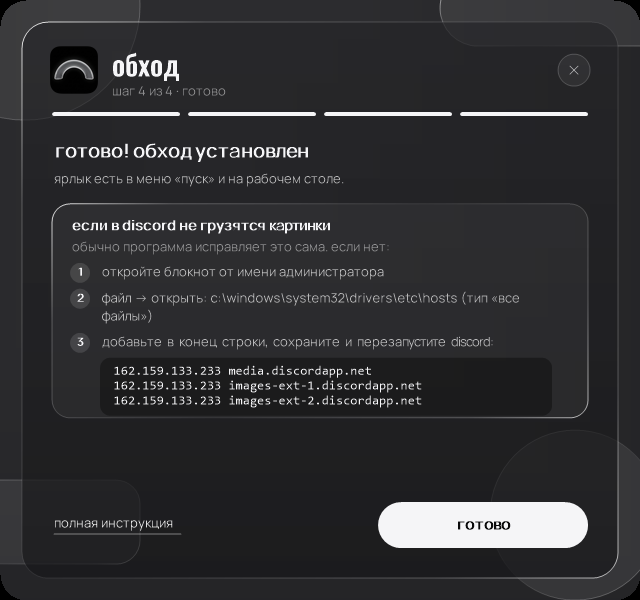

<p align="center">
  
</p>

<h1 align="center">обход</h1>

<p align="center">
  Запрет, прокси для Telegram и VPN в одной программе для Windows.<br>
  Три большие кнопки, автоматический подбор стратегии и обновления с GitHub.
</p>

<p align="center">
  <a href="../../releases/latest"><b>Скачать последнюю версию</b></a>
</p>



## Что умеет

**Запрет** (на основе [zapret-discord-youtube](https://github.com/Flowseal/zapret-discord-youtube) и [zapret](https://github.com/bol-van/zapret))
- Открывает YouTube, Discord, сайты на Cloudflare и другие сервисы без VPN.
- Сам перебирает стратегии и выбирает ту, что работает у вашего провайдера. Последняя удачная запоминается, поэтому при следующем запуске всё включается за пару секунд.
- Кроме штатных стратегий Flowseal есть собственные стратегии с подписью **DAVL**.
- Тест прямо в программе: TLS 1.2, TLS 1.3 и загрузка 64 КБ, чтобы поймать «заморозку» соединения на 16–20 КБ.
- Готовый список сервисов с логотипами (Discord, YouTube, Twitch, X, Instagram, WhatsApp, Telegram Web, Roblox и другие) и добавление своих доменов.
- Если провайдер блокирует по IP сервер картинок Discord, программа находит рабочий адрес и прописывает его в `hosts`.

**Telegram** (на основе [tg-ws-proxy](https://github.com/Flowseal/tg-ws-proxy))
- Локальный MTProto-прокси. Кнопка «подключить в telegram» сама добавляет его в Telegram.

**VPN** (ядро [Xray](https://github.com/XTLS/Xray-core), режим «весь трафик» через [sing-box](https://github.com/SagerNet/sing-box))
- Понимает те же ссылки, что Happ и Incy: подписки `https://`, `vless://` (Reality, XHTTP), `vmess://`, `trojan://`, `ss://`, `happ://add/…`, `incy://add/…`, `incy://crypt1/…`.
- Два режима: «системный прокси» и «весь трафик (TUN)».
- Российские сайты можно пустить напрямую, мимо VPN.
- Пинг серверов, обновление подписок, поддержка лимита устройств (HWID) у панелей Remnawave.

**Ещё**
- Обновления запрета, прокси и ядер VPN с GitHub в одно нажатие.
- Тёмная монохромная тема «жидкое стекло», вариант «графит» и «чёрная».
- Работа из трея и автозапуск вместе с Windows.

## Скриншоты

| Сервисы | VPN |
|---|---|
|  |  |
| **Тесты** | **Обновления** |
|  |  |

Установщик:

| | | | |
|---|---|---|---|
|  |  |  |  |

## Установка

1. [Скачайте `obhod-setup.exe`](../../releases/latest/download/obhod-setup.exe). При обычном запуске установщик проверяет новые стабильные релизы приложения на GitHub и предлагает скачать и открыть более свежий установщик. Если GitHub временно недоступен, открывается мастер для версии из скачанного файла.
2. Запустите его и пройдите четыре шага. Нужны права администратора: этого требует драйвер WinDivert, на котором работает запрет.
3. Во время установки нужен интернет. Если на компьютере нет .NET 10 Desktop Runtime, он скачается с сайта Microsoft (около 60 МБ). Прокси для Telegram скачается с GitHub (около 21 МБ). Ядра VPN скачиваются только по кнопке во вкладке VPN.

Программа ставится в `C:\Program Files\obhod`. Настройки и инструменты лежат в `C:\ProgramData\obhod`: путь всегда латиницей, иначе winws может не работать. Удалить программу можно через «Параметры → Приложения → обход».

## Антивирус ругается — что делать

Это ложное срабатывание. Защитник Windows иногда называет программу «трояном» или HackTool, потому что:
- запрет (`winws.exe`) перехватывает сетевой трафик через драйвер WinDivert, и так же делают вирусы;
- программа правит системный файл `hosts`, чтобы открыть картинки Discord;
- у файлов нет цифровой подписи, а для работы нужны права администратора;
- установщик и программа докачивают файлы из интернета;
- файл пришёл через Discord, Telegram или браузер, и Windows помечает его как скачанный из интернета.

Если файл удалили или заблокировали: «Безопасность Windows» → «Защита от вирусов и угроз» → «Журнал защиты» → выберите запись → «Разрешить на устройстве». Надёжнее добавить папки `C:\Program Files\obhod` и `C:\ProgramData\obhod` в исключения.

## В Discord не грузятся картинки

Обычно программа исправляет это сама. Если нет:

1. Откройте Блокнот от имени администратора.
2. «Файл → Открыть»: `C:\Windows\System32\drivers\etc\hosts`. В поле типа выберите «Все файлы».
3. Добавьте в конец строки, сохраните и перезапустите Discord (или нажмите в нём `Ctrl+R`):

```
162.159.133.233 media.discordapp.net
162.159.133.233 images-ext-1.discordapp.net
162.159.133.233 images-ext-2.discordapp.net
```

У другого провайдера рабочий адрес может отличаться. Подойдёт любой адрес `cdn.discordapp.com`, который у вас открывается (проверить: `ping cdn.discordapp.com`).

## Частые вопросы

**Нужен ли VPN, чтобы работали YouTube и Discord?**
Нет. Для них хватит кнопки «запрет». VPN нужен для сервисов, которые заблокированы по IP: в списке сервисов они помечены «блок по ip, нужен vpn».

**Какая стратегия лучше?**
Нажмите «подобрать лучшую». Программа проверит стратегии на ваших сервисах и включит ту, что прошла больше всего проверок.

**Подписка VPN пишет «Макс. число устройств превышено».**
Программа занимает одно место в лимите устройств, как отдельное приложение. Удалите старое устройство в боте или личном кабинете вашего VPN-сервиса и добавьте подписку снова.

**Ссылка `happ://crypt…` не добавляется.**
Такие ссылки зашифрованы, и расшифровать их может только сам Happ. Попросите у сервиса обычную ссылку на подписку `https://…`. Ссылки `incy://crypt1/…` поддерживаются.

**Где логи?**
`C:\ProgramData\obhod\hub.log`, а также кнопка «журнал» в настройках. Лог установщика: `%TEMP%\obhod-setup.log`.

## Сборка из исходников

Нужен .NET 10 SDK.

```powershell
cd src\app
dotnet publish -c Release -r win-x64 --self-contained false -p:PublishSingleFile=true -o ..\..\publish\app
```

Установщик (`src\Setup`, .NET Framework 4.8) встраивает `payload.zip` с папками `app\` (`obhod.exe`) и `data\zapret\` (копия zapret-discord-youtube):

```powershell
cd src\Setup
dotnet build -c Release -o ..\..\publish\setup
```

Ключи установщика: `/silent` (тихая установка или обновление), `/uninstall`, `/selftest` (проверка загрузок без установки).

## Благодарности и лицензии

Код программы и установщика распространяется по лицензии MIT, см. [LICENSE](LICENSE). Автор: **DAVL**.

Программа использует и скачивает сторонние проекты, у которых свои лицензии. Список: [THIRD_PARTY.md](THIRD_PARTY.md). Огромное спасибо авторам [zapret](https://github.com/bol-van/zapret), [zapret-discord-youtube](https://github.com/Flowseal/zapret-discord-youtube), [tg-ws-proxy](https://github.com/Flowseal/tg-ws-proxy), [Xray](https://github.com/XTLS/Xray-core), [sing-box](https://github.com/SagerNet/sing-box) и [WinDivert](https://github.com/basil00/WinDivert).

> Программа предназначена для доступа к информации и не собирает данные пользователей. Используйте её в рамках законов вашей страны.
